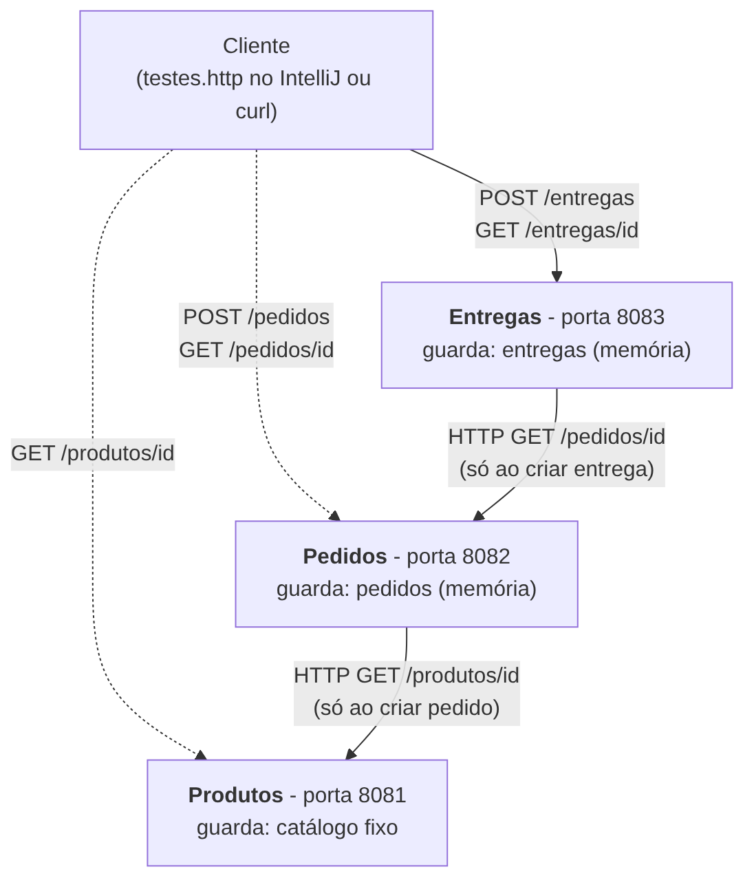

# Microsserviços em Java - Serviço de Entregas

**Dupla:** Enzo Mestrinel e Otávio Barbosa

Projeto da atividade de microsserviços com Java no IntelliJ IDEA. Nós implementamos o terceiro serviço, **Entregas** (porta 8083). Os serviços **Produtos** (8081) e **Pedidos** (8082) vieram prontos do professor e estão neste repositório só para podermos rodar os testes.

## O que tem no repositório

| Pasta / arquivo | O que é |
|---|---|
| `entregas-service/` | **Nosso trabalho**: `src/Entregas.java`, `testes.http` e a configuração do IntelliJ |
| `produtos-service/` | Serviço de apoio (do professor), porta 8081 |
| `pedidos-service/` | Serviço de apoio (do professor), porta 8082 |
| `docs/arquitetura.png` | Desenho da arquitetura |
| `docs/matriz-de-testes.md` | Matriz de testes: esperado x obtido x evidência |
| `docs/evidencias/` | Saídas reais dos testes e logs dos serviços |
| `scripts/executar-testes.sh` | Script que roda todos os testes e gera as evidências |
| `.gitignore` | Ignora `out/`, `*.class` e arquivos temporários do IntelliJ |

## Requisitos

- IntelliJ IDEA (Community serve).
- JDK **17 ou superior** completo (precisa do módulo `jdk.httpserver`).
- Portas **8081, 8082 e 8083** livres.
- Não precisa de Spring, Maven, Gradle nem banco de dados.
- Para o script opcional: `bash`, `curl` e `python3` (Linux, macOS ou Git Bash).

## Arquitetura



- Cada serviço é um programa Java **separado**, com sua própria porta e sua **própria memória**. Ninguém acessa os dados do outro; só conversam por HTTP.
- **Entregas -> Pedidos**: ao criar uma entrega, Entregas faz `GET /pedidos/{id}` em Pedidos para saber se o pedido existe.
- **Pedidos -> Produtos**: ao criar um pedido, Pedidos consulta Produtos (isso já vinha pronto).
- Entregas **não** fala com Produtos.
- Consultar uma entrega (`GET /entregas/{id}`) olha **só a memória local** de Entregas. Por isso funciona mesmo com Pedidos parado.
- Os dados ficam em memória: ao reiniciar o serviço, tudo é perdido.

## Como executar no IntelliJ

Cada serviço é um projeto separado do IntelliJ (como nas aulas). Repita os passos abaixo para as três pastas: `produtos-service`, `pedidos-service` e `entregas-service`.

1. Clone o repositório (ou baixe e extraia).
2. No IntelliJ: **File > Open** e escolha a pasta do serviço (por exemplo `produtos-service`). Para os outros, escolha **New Window** para manter os anteriores abertos.
3. **File > Project Structure > Project**: escolha o **Project SDK** (JDK 17 ou superior). O nome do JDK muda de computador para computador.
4. Em **Modules > Sources**, a pasta `src` deve estar marcada como fonte.
5. Abra o arquivo em `src` (`Produtos.java`, `Pedidos.java` ou `Entregas.java`) e clique no ícone verde ao lado do `main`. Também existe a configuração de execução pronta (`Produtos`, `Pedidos`, `Entregas`) que já inclui `--add-modules jdk.httpserver`.
6. Espere a mensagem no console e **deixe rodando**:
   - `Produtos em http://localhost:8081`
   - `Pedidos em http://localhost:8082`
   - `Entregas em http://localhost:8083`

**Ordem para iniciar:** Produtos, depois Pedidos, depois Entregas.

### Alternativa pelo terminal

Em três terminais, cada um dentro da pasta `src` do serviço:

```text
java --add-modules jdk.httpserver Produtos.java
java --add-modules jdk.httpserver Pedidos.java
java --add-modules jdk.httpserver Entregas.java
```

### Variável opcional

O Entregas procura o Pedidos em `http://localhost:8082`. Para mudar, use **Run > Edit Configurations > Entregas > Environment variables** e coloque `PEDIDOS_URL=http://localhost:8082` (sem barra no final).

## Como executar os serviços de Produtos e Pedidos nos testes

Eles são necessários porque o Entregas só cria uma entrega se o pedido existir:

1. Suba **Produtos** (8081) e **Pedidos** (8082) como descrito acima.
2. Crie um pedido: `POST http://localhost:8082/pedidos` com corpo `1` (tipo `text/plain`). A primeira vez devolve `201` com `{"id":1,"produto":{...},"status":"CRIADO"}`.
3. Agora o pedido `1` existe e o Entregas consegue criar entregas para ele.
4. Os produtos existentes são `1` (Caderno) e `2` (Caneta). Pedidos fica em memória: se reiniciar Pedidos, crie o pedido de novo.

## Contrato do serviço de Entregas

| Operação | Entrada | Resultado |
|---|---|---|
| `POST /entregas` | ID inteiro positivo do pedido, em `text/plain` | `201` + `Location: /entregas/{id}`; `400` entrada inválida; `413` corpo > 64 bytes; `422` pedido inexistente (não grava); `503` Pedidos fora do ar ou status inesperado (não grava) |
| `GET /entregas/{id}` | ID no caminho | `200` ou `404`; `400` se o ID não for inteiro |
| Método errado em rota conhecida | - | `405` com cabeçalho `Allow` |
| Qualquer outra rota | - | `404` |

Exemplo de resposta de sucesso:

```json
{"id":1,"pedidoId":1,"status":"AGUARDANDO_ENVIO"}
```

Na versão básica, várias entregas para o mesmo pedido são permitidas. Timeouts: 2 s para conectar e 3 s por requisição.

## Como executar os testes

### Opção 1: IntelliJ (`testes.http`)

1. Deixe os 3 serviços rodando.
2. Abra `entregas-service/testes.http` e clique no botão verde de cada requisição, **na ordem**: 1, 2, 3, 4 ...
3. Os números são só a ordem sugerida, não são IDs da API. Ajuste o ID da consulta se necessário.
4. **Não rode tudo de uma vez.** Os testes 20, 21 e 25 pedem que você pare um serviço na mão (Stop no console do IntelliJ):
   - **20**: pare só **Produtos**, depois rode.
   - **21 e 22**: pare **Pedidos**, depois rode.
   - **25**: reinicie **Entregas** e consulte a entrega 1 (deve dar 404).

Se o IntelliJ da sua instalação não executar arquivos `.http`, use `curl` (Windows PowerShell com `curl.exe`):

```bash
curl -i -X POST http://localhost:8082/pedidos -H "Content-Type: text/plain" --data "1"
curl -i -X POST http://localhost:8083/entregas -H "Content-Type: text/plain" --data "1"
curl -i http://localhost:8083/entregas/1
```

### Opção 2: script automático

```bash
bash scripts/executar-testes.sh
```

Ele sobe os três serviços, executa os 27 cenários (inclusive parar e reiniciar serviços), mostra o resumo na tela e grava tudo em `docs/evidencias/`.

## Matriz de testes

Resumo (detalhes e evidências em [`docs/matriz-de-testes.md`](docs/matriz-de-testes.md)):

| Grupo | Testes | Resultado |
|---|---|---|
| Fluxo principal (criar e consultar entrega) | T01 a T05 | passaram |
| Validações (400, 405, 404, 413, 422) | T06 a T16 | passaram |
| Produtos parado (Entregas continua funcionando) | T17, T18 | passaram |
| Pedidos parado (503 na criação, GET continua) | T19 a T23 | passaram |
| Pedidos devolvendo status inesperado (500) | T24, T25 | passaram |
| Reinício de Entregas (perda da memória) | T26, T27 | passaram |

Total: **27 de 27 testes passaram**.

## Divisão do trabalho e participação

Usamos um repositório só da dupla, com commits de cada um (veja `git log --format="%an | %s"`).

**Otávio Barbosa**
- Preparou o repositório e o `.gitignore`, e trouxe os serviços de apoio (Produtos e Pedidos).
- Implementou a consulta `GET /entregas/{id}` usando a memória local.
- Implementou o tratamento de falhas e validações: 422, 503, 405, 413.
- Fez o script de testes e a matriz de testes com as evidências.

**Enzo Mestrinel**
- Criou o projeto IntelliJ de Entregas e o servidor HTTP na porta 8083.
- Implementou o `POST /entregas` com a integração HTTP ao serviço de Pedidos.
- Escreveu o arquivo `testes.http`.
- Escreveu o README e fez o desenho da arquitetura.

Cada um de nós sabe explicar o código inteiro do Entregas (explicação individual).

## Decisões simples que tomamos

- **Por que 422 e não 404 quando o pedido não existe?** O endereço `/entregas` existe; o problema é o conteúdo enviado (um pedido que não existe).
- **Por que 503 quando Pedidos cai?** O erro não é do cliente: um serviço de que dependemos está fora do ar.
- **Por que o ID da entrega só é gerado depois do 200?** Assim, falhas não consomem ID nem gravam nada (comprovado no teste T23).
- **Por que o GET não chama Pedidos?** Cada serviço é dono dos seus dados. Entregas já tem o que precisa na própria memória.

## Limites desta versão (didáticos)

Sem banco de dados, sem autenticação, sem HTTPS, sem proteção contra POST duplicado, sem retry. Servidores acessíveis somente no próprio computador (`127.0.0.1`).
